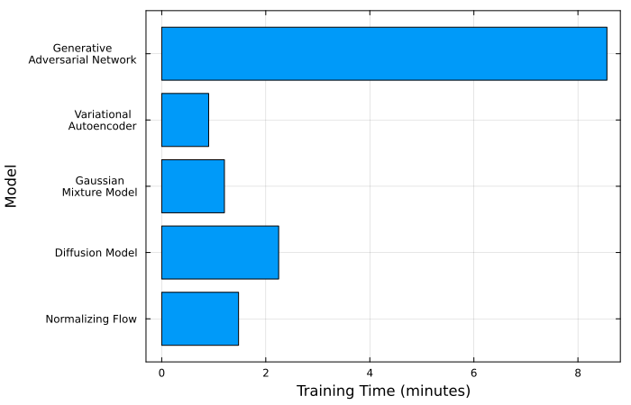
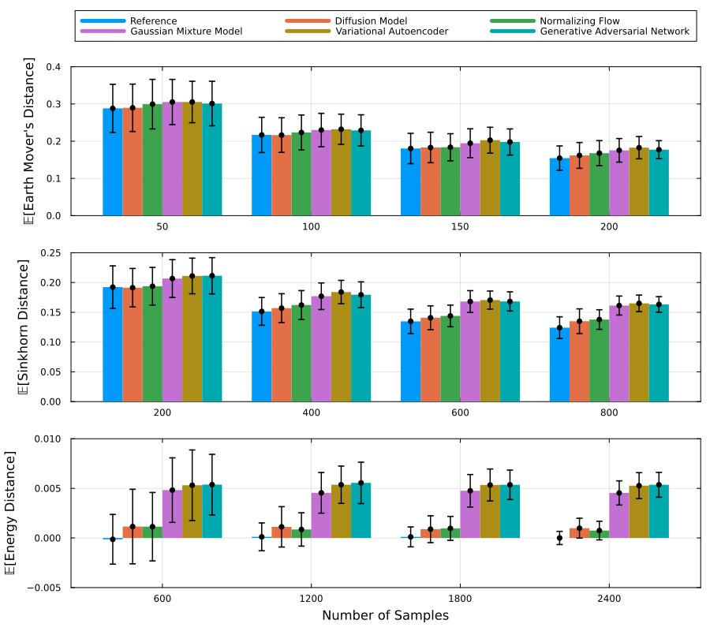

# Comparing Models

In this example we explore the use of the three different distribution distances
bundled as extensions of this module. The first step to use this extensions
is to load this module and the extension's dependencies
```julia
using GenerativeModelProtocols
using Distances, OptimalTransport, Tulip
```

The three available distribution distances available as extensions of this
module are:

  - `GenerativeModelProtocols.earth_mover_distance`
  - `GenerativeModelProtocols.sinkhorn_distance`
  - `GenerativeModelProtocols.energy_distance`

for details regarding the theory, how they are calculated, and the convergence
rate of these distribution distances please visit their respective pages in the
**Distribution Distances** section of this documentation.

## Training and Saving the Models

In this example we will use the same data distribution used in the **Getting
Started** examples. More concretely
```julia
function make_data(num_samples)
    t = (2.0*π) .* rand(Float64,num_samples)

    x_noise = 0.05 .* randn(Float64,num_samples)
    y_noise = 0.05 .* randn(Float64,num_samples)

    x = cos.(1.0.*t) .+ x_noise
    y = sin.(2.0.*t) .+ y_noise

    return x, y
end

num_samples = 5000
x_train, y_train = make_data(num_samples)
train_data = collect(transpose(hcat(x_train,y_train)))
```
thus, we can, for example, train and save a Diffusion Model (DM) with
```julia
using Reactant
using FileIO, HDF5

model = GenerativeModelProtocols.DiffusionModel(2, 250)
protocol = GenerativeModelProtocol(model, train_data)
train_log = train!(protocol;
    batchsize = 256,
    epochs    = 3500,
    optimiser = Adam(; eta = 1.0E-3, beta = (0.95,0.999)),
    device    = reactant_device()
)
save("trained_models/dm_model.h5", protocol)
```
and similarly for any of the other generative models available within this
module (check `train_modes.jl` in the examples folder of this example).

## Training Walltime Comparisons

Although these metrics may be of limited interest to end users, training time
and the training trace can be accessed through the following fields:
```julia
train_elapsed = train_log.elapsed
train_trace = train_log.trace
```

For the models considered in this example, the Generative Adversarial Network
(GAN) takes considerably longer to train than the other models. This is
expected, given the use of a gradient penalty to constrain the Lipschitz
constant. The Diffusion Model (DM) takes approximately twice as long to train as
the Gaussian Mixture Model (GMM) and the Normalizing Flow (NF). The Variational
Autoencoder (VAE) has the shortest training time, although its advantage over
the GMM and NF is relatively small.

All models were trained for 3500 epochs using `reactant_device()` as the target
device and `Reactant.jl`'s default CPU backend. The experiments were conducted
on a system equipped with an Intel Core Ultra 7 255H (16 logical processors),
running Ubuntu 26.04.1 and Julia 1.13.2.



## Distribution Distances

To compare how accurate is the learned distribution of the models we can use
distribution distances. These distances provide us with metrics we can use to
establish which of our trained models is more accurate.

To test, for example, the energy distance we begin by making some target test
data (the training data or a different dataset can be used)
```julia
make_test_data(n) = collect(transpose(hcat(make_data(n)...)))
test_data = make_test_data(50)
```
we can then estimate the energy, sinkhorn and earth mover's distances with
```julia-repl
julia> [GenerativeModelProtocols.energy_distance(protocol, test_data) for _ in 1:3]
3-element Vector{Float64}:
 0.01595552150364532
 0.028605759171251632
 0.050649833948142264

julia> [GenerativeModelProtocols.sinkhorn_distance(protocol, test_data) for _ in 1:3]
3-element Vector{Float64}:
 0.3617521061608876
 0.4137834354567416
 0.23351136512088239

julia> [GenerativeModelProtocols.earth_mover_distance(protocol, test_data) for _ in 1:3]
3-element Vector{Float64}:
 0.2196202701858471
 0.32449728065684535
 0.239423579252696
```
likewise, we can establish baseline results using the exact data distribution
with
```julia-repl
julia> [GenerativeModelProtocols.energy_distance(make_test_data(50), test_data) for _ in 1:3]
3-element Vector{Float64}:
 -0.00943460948406516
  0.04467508539746823
 -0.007815869732488157

julia> [GenerativeModelProtocols.sinkhorn_distance(make_test_data(50), test_data) for _ in 1:3]
3-element Vector{Float64}:
 0.2546012264016766
 0.3879326669032912
 0.3027651251029292

julia> [GenerativeModelProtocols.earth_mover_distance(make_test_data(50), test_data) for _ in 1:3]
3-element Vector{Float64}:
 0.3332713794784428
 0.3056585730619645
 0.33646876306676465
```
thus, repeating this experiment with larger sample sizes we can estimate more
accurately the distribution distances.



In the plots above, each distribution distance was estimated over 200 trials for
each sample size shown on the x-axis. The histogram heights represent the mean
distance across these trials, while the error bars indicate the standard
deviation.

Across all three distribution distances, the results indicate that the Diffusion
Model (DM) and Normalizing Flow (NF) achieve the highest accuracy, followed by
the Gaussian Mixture Models (GMMs), with the Variational Autoencoders (VAEs) and
Generative Adversarial Networks (GANs) performing least accurately. Among the
three metrics, the energy distance provides the clearest comparison of model
performance, primarily because it allows for larger sample sizes.

The sample sizes used for each distribution distance differ because of their
respective computational costs.

## Inference Walltime Comparisons

The final relevant comparison between models is their inference time. That is,
how long do they take at making new synthetic data. For example, we can test
how long it takes of a `protocol` to produce 50 new synthetic data points
with
```julia
t0 = time()
protocol(50)
t1 = time()
```

In our supplied Julia script for this example, namely
`examples/compare_models/plot_comparisons.jl`, we measure the inference time
for three difference batch sample sizes 200 times and report their mean
and standard deviation values.

| Model | 100 samples | 200 samples |
|:---|---:|---:|
| Diffusion Model | 5.11e+01 ± 1.28e+01 | 9.69e+01 ± 2.11e+01 |
| Normalizing Flow | 1.75e+00 ± 1.17e+00 | 3.61e+00 ± 5.98e+00 |
| Gaussian Mixture Model | 2.45e-02 ± 1.76e-03 | 3.30e-02 ± 1.19e-03 |
| Variational Autoencoder | 3.13e-02 ± 3.50e-03 | 5.69e-02 ± 1.23e-03 |
| Generative Adversarial Network | 3.01e-02 ± 2.13e-03 | 5.63e-02 ± 1.64e-03 |

*Inference time in milliseconds; values are mean ± standard deviation.*

For this experiment we can observe that the VAE, GAN and GMM models perform
equaly as fast when it comes to inference speed. The NF while performing
substantially faster at inference compared to the DM, it is considerably slower
than the GMM, VAE and GAN. Finally, the DM is unsurprisingly the slowest at
inference since it requires 250 denoising steps for every sample at inference.

## Source Code

The scripts used to create and train the models, and to produce all the plots
shown in this page are included in the examples folder of this module.
```bash
cd /path/to/GenerativeModelProtocols.jl/examples/compare_models
julia train_models.jl
julia compare_models.jl
julia plot_comparisons.jl
```

